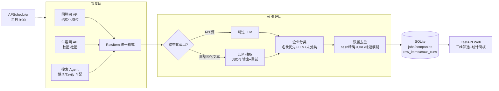

# 🎯 秋招雷达 JobRadar

> **把"每天刷 5 个招聘网站 30 分钟"变成"打开一个页面 3 分钟"。**

## 为什么做这个

每一届秋招学生（尤其是要同时考虑央国企、民企、外企的同学）都在重复同样的事情：

1. **信息分散**：国聘网、牛客、各企业官网、招聘 App——每天要挨个刷一遍，漏一个渠道可能就错过一个批次
2. **央国企窗口短**：央企国企的网申通常只开 1~2 周，信息滞后几天就是直接损失
3. **招聘 App 不按企业性质组织信息**："只看央国企校招"这个高频需求，主流产品都没有对应筛选项

秋招雷达在配置好定时任务后，每天 9:00 自动从公开渠道采集岗位，结构化入库，按 **企业性质（央国企/民企/外企/未分类）× 招聘类型（校招/社招）× 关键词** 三维筛选，并尽量提供投递入口。

**适合谁**：2026/2027 届计算机、AI 方向求职者；也适合想观察各类型企业招聘动向的人。

## 在线体验

- **Render 在线演示**：<https://job-radar-zrsz.onrender.com>（免费实例 15 分钟无访问会休眠，唤醒约 1 分钟；首次冷启动会在后台自动采集）
- 重新部署：[](https://render.com/deploy?repo=https://github.com/FanXiaofu/job-radar)（首次部署约 2–5 分钟）
- Hugging Face Space：Docker/Gradio 当前为 Paid；免费账号只能用 Static，Static 无法运行 FastAPI，不建议用于本项目
- 🖥️ 本地运行：见下方[快速开始](#快速开始)，或用 cpolar 内网穿透（见 [DEPLOY.md](DEPLOY.md)）

数据全部来自公开渠道（国聘网、牛客网），仅供求职参考，投递以企业官方页面为准。

## 实测数据（开发期连续采集）

| 指标 | 数值 |
|---|---|
| 岗位入库 | **1487**（历史 4 轮 1021 + 2026-10-29 增量 466） |
| 默认可见 | **906 / 1487**（近 30 天；`JOB_MAX_AGE_DAYS` 可调） |
| 截止日期 | **1041 / 1487**（其余 446 条源数据为长期/未注明） |
| 覆盖企业 | **572 家**；岗位口径（当前库）：未分类 764 / 民企 493 / 央国企 207 / 外企 23 |
| 去重识别率 | **56.4%**（1926 重复 /（1926 重复 + 1487 新增），含 2026-10-29 增量） |
| 单轮全量采集 | **~2 分钟**（2026-10-29 完整刷新实测 1m48s；只跑牛客 1m35s；优化前 13m58s / 7m58s） |

> 口径说明：历史 4 轮基线为 **1021 岗位 / 423 企业**（2026-09-11 ~ 2026-09-12）；2026-10-29 完整刷新后当前库为 **1487 岗位 / 572 企业**。简历中的 1021/423 保留为 4 轮基线口径。数据库文件不提交到仓库，重新 clone 后需先跑一轮采集。LLM 抽取与搜索 Agent 默认关闭，当前数据全部来自国聘/牛客两个结构化 API。
>
> Render 演示实例使用独立 SQLite：首次冷启动会重新采集，岗位数与上表的本地 1487 快照可能不同（本次实测首次采集 901 条）。
>
> 2026-10-29 用临时库重跑验证新口径：985 原始 → 811 新增 / 137 去重 / 37 错误，`status=partial`，耗时 13m58s（修复重复限速前）。
>
> 2026-10-29 去除牛客企业页重复限速后再次重跑：985 原始 → 808 新增 / 135 去重 / 42 错误，`status=partial`，耗时 7m58s。
>
> 2026-10-29 牛客改用接口企业名 + 职位详情页后重跑：950 原始 → 809 新增 / 141 去重 / 0 错误，`status=success`，耗时 1m35s。
>
> 2026-10-29 R3 地点去重（真实库副本验证）：621 原始 → 290 新增 / 331 去重 / 298 补齐链接。旧库约 100 个跨城市岗位此前被合并，重跑后会拆分为独立岗位。
>
> 2026-10-29 完整真实库刷新：954 原始 → 466 新增 / 488 去重 / 298 补齐 `apply_url` / 0 错误，`status=success`，耗时 1m48s；当前库 1487 岗位 / 572 企业。
>
> 牛客链接现状：真实刷新后牛客 937 条，584 条有详情页链接；298 条旧岗位补齐，353 条旧岗位当前接口未返回，仍无链接。后续需要过期下架或二次补链。
>
> 展示策略：默认只展示最近 30 天有更新的岗位（`JOB_MAX_AGE_DAYS`，当前 906/1487；未分类 447 / 民企 318 / 央国企 127 / 外企 14）；勾选“显示历史岗位”可查看全部。过期岗位不删除，只隐藏。
>
> 2026-10-29 deadline 落库：1041/1487 条有结构化截止日期，支持按截止日期排序和“只看未截止”；446 条源数据为长期/未注明。超过 5 年的 2126 哨兵值已从字段和 requirements 文本中清理。
>
> 2026-10-29 按 A 方案回填真实库：399 家来源先验企业、960 个岗位改为“未分类”。
>
> 2026-10-29 扩充民企名录和央企子公司简称后重分类：89 家企业 / 448 个岗位从“未分类”升级为名录结果；完整刷新后当前未分类 764（51.4%）、民企 493、央国企 207、外企 23。

## 架构



**核心设计决策**：
- **结构化 API 直出，跳过 LLM**：国聘/牛客都探明了匿名可用的数据接口，字段直接来自接口，避免 LLM 抽取误差和 token 成本；LLM 只处理搜索 Agent 命中的非结构化网页
- **名录优先分类**：100 家央企集团 + 90 家外企 + 常见民企名录子串匹配（置信度 1.0），未命中走 LLM（0.7）；都没有命中时标记为 `unknown`（未分类，0.3），不按来源平台猜测
- **双层去重**：content_hash 精确层 + 同企业内“地点兼容 + URL 归一化/标题相似度”模糊层；跨城市不合并，地点为空时才允许标题模糊匹配
- **投递链接**：国聘用岗位详情页；牛客优先 `redirectExternalUrl`，缺失时用 `https://www.nowcoder.com/jobs/detail/{id}`，不再留空按钮
- **截止日期**：报名截止日期落库，支持按截止日期排序和“只看未截止”；超过 5 年的源哨兵值视为未注明

> 分类口径：已按 A 方案改为“只展示高置信度结果”，未命中名录/LLM 的企业统一标记为“未分类”。当前未配置 LLM Key，572 家企业中 439 家仍为未分类，岗位层面未分类 764（51.4%）；民营/央企/外企分别覆盖 493/207/23 个岗位。下一阶段可启用 LLM 或继续补长尾名录。

## 快速开始

```bash
git clone https://github.com/FanXiaofu/job-radar.git
cd job-radar
pip install -r requirements.lock
cp .env.example .env        # 填入 LLM_API_KEY（可选，推荐 DeepSeek）
python main.py crawl        # 立即采集一轮（约 2 分钟，视岗位数量）
python main.py serve        # 启动 Web + 每天 9:00 定时采集
# 浏览器打开 http://127.0.0.1:8000
```

Windows 用户可直接双击 `start.bat`。Docker 用户：`docker compose up -d --build`。

## 配置

| 变量 | 说明 | 默认 |
|---|---|---|
| LLM_API_KEY / LLM_BASE_URL / LLM_MODEL | OpenAI 兼容接口 | DeepSeek |
| SEARCH_PROVIDER / SEARCH_API_KEY | bocha / tavily / none | none |
| SCHEDULE_HOUR / SCHEDULE_MINUTE | 每日采集时刻 | 9:00 |
| JOB_MAX_AGE_DAYS | 页面默认展示最近 N 天有更新的岗位 | 30 |
| PORT / WEB_PORT | 监听端口（容器平台注入 PORT） | 8000 |

## 质量保障

- **一键测试**：`pip install -r requirements-dev.lock && pytest`（22 个用例，自动发现 `tests/`）
- **CI**：GitHub Actions 在 push/PR 时执行 `compileall` + `pytest`（[.github/workflows/ci.yml](.github/workflows/ci.yml)）
- **依赖锁定**：`requirements.lock` / `requirements-dev.lock` 为 pip-compile 生成的全量锁定；`requirements.txt` / `requirements-dev.txt` 是源文件，已移除未使用的 playwright
  - 更新依赖：`pip install pip-tools` 后执行 `pip-compile requirements.txt -o requirements.lock --no-emit-index-url --no-emit-trusted-host --no-strip-extras` 和 `pip-compile requirements-dev.txt -o requirements-dev.lock --no-emit-index-url --no-emit-trusted-host --no-strip-extras`
  - Windows 上 pip-compile 会省略 Linux 专属的 uvloop，lock 中已手动保留带 `sys_platform != "win32"` marker 的固定版本
- **Docker 冒烟**：`docker build` 使用 `requirements.lock`；容器 `HEALTHCHECK` 状态为 healthy；`docker compose up -d --build` 后 `/health` 返回 906/1487，已实际验证并清理容器/镜像
- **独立 AI 评审闭环**：开发中由全新上下文的 AI 评审员按六项 checklist 审查，第一轮发现 6 项 P1 + 17 项 P2，第二轮复审结论“可交付”——完整报告见 [docs/reviews/](docs/reviews/)。注意：第一轮修复记录中的部分回归数据早于修复提交，已在审计更正中标注。
- **单元测试**：`python tests/test_dedup.py`（去重与分类，不依赖网络）
- **流水线集成测试**：`python tests/test_pipeline.py`（临时 SQLite + 假数据源，覆盖新增/重复/补字段/数据源失败/异常收尾）
- **Web 测试**：`python tests/test_web.py`（`/health`、筛选、分页、过期岗位、截止日期、XSS 转义）
- **牛客数据源测试**：`python tests/test_nowcoder.py`（详情页链接、企业名、广告卡片过滤）
- **分类回填测试**：`python tests/test_backfill.py`（dry-run、写入、幂等）
- **重分类测试**：`python tests/test_reclassify.py`（名录重分类、写入、幂等）
- **deadline 回填测试**：`python tests/test_backfill_deadline.py`
- **迁移测试**：`python tests/test_migration.py`（旧库补 deadline 列/索引）
- **抽取评测集**：15 条人工标注样本，`python eval/run_eval.py` 输出字段级准确率（需要 `LLM_API_KEY`）
- **分类回填**：`python scripts/backfill_unknown_category.py --db data/job.db`（默认 dry-run，加 `--apply` 写入；可重复执行）
- **企业重分类**：`python scripts/reclassify_companies.py --db data/job.db`（默认 dry-run，加 `--apply` 写入；可重复执行）
- **deadline 回填**：`python scripts/backfill_deadline.py --db data/job.db`（默认 dry-run，加 `--apply` 写入；可重复执行）
- **运行留痕**：每轮采集的新增/去重/补齐/错误数落库（`crawl_runs`），原始数据先独立提交再处理（`raw_items`）

### 运行记录口径

| 字段 | 含义 |
|---|---|
| `started_at` | 本轮采集开始时间（第一个数据源请求前） |
| `finished_at` | 本轮采集与入库处理结束时间 |
| `total_raw` | 本轮采集到的原始条目数 |
| `new_jobs` | 新入库岗位数 |
| `duplicates` | 命中去重的条目数 |
| `updated_jobs` | 重复条目中补齐了缺失字段的数量 |
| `errors` | 数据源失败、单条处理失败、校验失败、整轮异常的总数 |
| `status` | `success`=0 错误且有产出；`partial`=有产出但有错误；`failed`=无产出或整轮异常 |

> `status` 与 `errors` 必须同时看：`success` 且 `total_raw=0` 不是正常状态——当前实现会把空采集标记为 `failed`，并写入“本轮未采集到任何条目”。

## License

仅供学习与个人求职使用。
